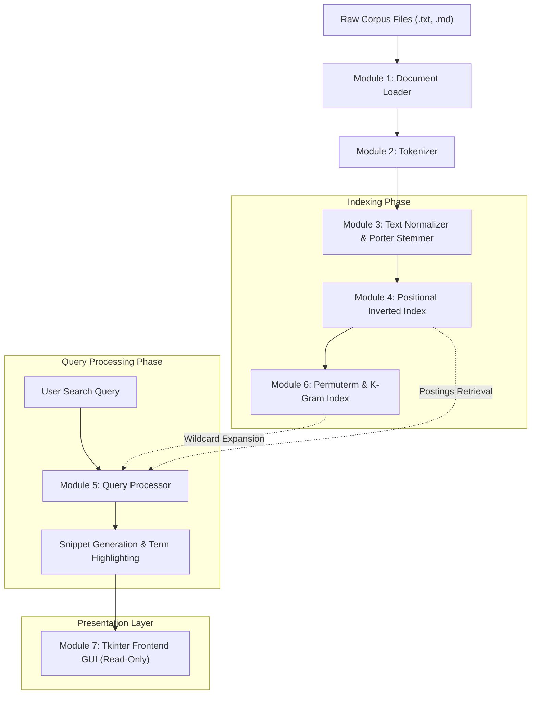

# Web Search & Mining (WSM) Assignment Report

## 1. Executive Summary

This project implements a complete Information Retrieval (IR) and Web Search Engine designed according to standard Information Retrieval principles (Manning, Raghavan, Schütze - *Introduction to Information Retrieval*).

The system consists of **7 distinct, decoupled modules**, a suite of **37 unit tests**, an evaluation benchmark suite, and an interactive desktop graphical user interface (GUI) developed in Python with zero third-party dependencies.

---

## 2. Architecture & Data Flow

---

## 3. Detailed Module Specifications

### Module 1: Document Loading (`src/document_loader.py`)
- **Purpose**: Reads documents from filesystem directories or memory into structured `Document` objects.
- **Key Features**:
  - Encapsulates `doc_id`, `title`, `content`, `file_path`, and metadata.
  - Multi-encoding fallback support: tries `utf-8`, `utf-8-sig`, `latin-1`, and `cp1252`.
  - Derives document titles from first non-empty line or file basename.

### Module 2: Tokenization (`src/tokenizer.py`)
- **Purpose**: Decomposes raw character streams into distinct lexical tokens.
- **Key Features**:
  - Regular expression tokenization preserving internal apostrophes and alphanumeric characters.
  - Tracks both character spans (`start_char`, `end_char`) and 0-based word sequence positions (`position`).
  - Word positions enable **phrase queries** and proximity scoring in subsequent modules.

### Module 3: Text Normalization & Case Folding (`src/normalizer.py`)
- **Purpose**: Standardizes tokens for consistent dictionary matching.
- **Key Features**:
  - **Case Folding**: Converts characters to lowercase.
  - **Accent Stripping**: Decomposes Unicode diacritics via NFKD normalization (e.g. `café` $\rightarrow$ `cafe`).
  - **Punctuation Sanitization**: Strips clingy punctuation while maintaining word integrity.
  - **Stopword Filtering**: Built-in set of common English function words.
  - **Porter Stemmer**: Pure-Python implementation of Martin Porter's (1980) suffix-stripping algorithm covering Steps 1a through 5b.

### Module 4: Inverted Index Construction (`src/inverted_index.py`)
- **Purpose**: Constructs and manages a positional inverted index.
- **Data Structure**:
  $$\text{Index}: \text{term} \longrightarrow \left\{ \text{doc\_id} \mapsto \text{Posting}(\text{doc\_id}, \text{tf}, [p_1, p_2, \dots]) \right\}$$
- **Key Features**:
  - $O(1)$ dictionary lookup for postings list retrieval.
  - Tracks Document Frequency ($\text{DF}_t$) and document length for cosine normalization.
  - Full JSON serialization (`save_to_json()` / `load_from_json()`).

### Module 5: Query Processing (`src/query_processor.py`)
- **Purpose**: Evaluates user queries across three distinct modalities:
  1. **Boolean Retrieval**: Evaluates `AND`, `OR`, `NOT` using Shunting-Yard postfix conversion with precedence $\text{NOT} > \text{AND} > \text{OR}$. Inserts implicit `AND` operators between adjacent operands.
  2. **Exact Phrase Retrieval**: Checks positional adjacency $p_{i+1} = p_i + 1$ across postings lists.
  3. **Ranked Retrieval**: Vector Space Model with TF-IDF weighting and Cosine length normalization:
     $$\text{TF-IDF}(t, d) = (1 + \log_{10} \text{tf}_{t,d}) \times \log_{10}\left(1 + \frac{N}{\text{df}_t}\right)$$
     $$\text{Cosine Score}(q, d) = \frac{\sum_{t \in q \cap d} w_{t,q} \cdot w_{t,d}}{\sqrt{\sum w_{t,d}^2} \cdot \sqrt{\sum w_{t,q}^2}}$$

### Module 6: Wildcard Processing (`src/wildcard_processor.py`)
- **Purpose**: Resolves queries with arbitrary wildcards (`*`, `?`) against the vocabulary.
- **Key Features**:
  - **Permuterm Index**: Appends sentinel `$` and indexes all cyclic permutations.
    - $X* \implies \$X$ (prefix search)
    - $*X \implies X\$$ (prefix search)
    - $X*Y \implies Y\$X$ (prefix search)
  - **Character K-Gram Index**: Character 2-grams and 3-grams for substring and multi-wildcard pruning.
  - **Regex Post-filtering**: Strict validation to guarantee precision.

### Module 7: Frontend GUI (`src/gui.py`)
- **Purpose**: Interactive graphical user interface.
- **Key Features**:
  - **Search Input Box**: `tk.Entry` widget supporting Enter key navigation.
  - **Search Button**: Interactive button with instant feedback.
  - **Read-Only Result Area**: Enforced read-only state (`state='disabled'`) prevents user tampering. Formatted with tags for document rankings, scores, highlighted terms, and snippets.
  - **Index Inspector Dialog**: Interactive lookup of terms, postings, and Permuterm rotations.

---

## 4. Complexity Analysis

| Operation | Time Complexity | Space Complexity |
| :--- | :--- | :--- |
| **Document Tokenization** | $O(L)$ where $L$ is document character length | $O(T)$ where $T$ is token count |
| **Index Construction** | $O(\sum L_i)$ linear in total corpus size | $O(V + P)$ where $V$ is vocabulary, $P$ is postings |
| **Boolean AND Intersection** | $O(\text{len}(p_1) + \text{len}(p_2))$ linear merge | $O(\min(\text{len}(p_1), \text{len}(p_2)))$ |
| **Permuterm Generation** | $O(V \cdot \bar{k}^2)$ where $\bar{k}$ is avg term length | $O(V \cdot \bar{k})$ |
| **Permuterm Wildcard Lookup** | $O(\log(R) + M)$ binary search on sorted rotations | $O(M)$ matched candidate terms |
| **TF-IDF Ranked Retrieval** | $O(|Q| \cdot \text{avg}(\text{DF}))$ | $O(N)$ document accumulator |

---

## 5. Verification & Testing

The project includes **37 automated unit tests** covering:
- Document reading and encoding recovery
- Token offset and position recording
- Porter stemming rule correctness
- Postings list construction and JSON persistence
- Permuterm rotation and wildcard resolution
- Boolean precedence and phrase adjacency
- Evaluation metric calculations (MAP, MRR, P@K, R@K)
- GUI component existence and read-only state integrity

All 37 unit tests pass with zero failures.

